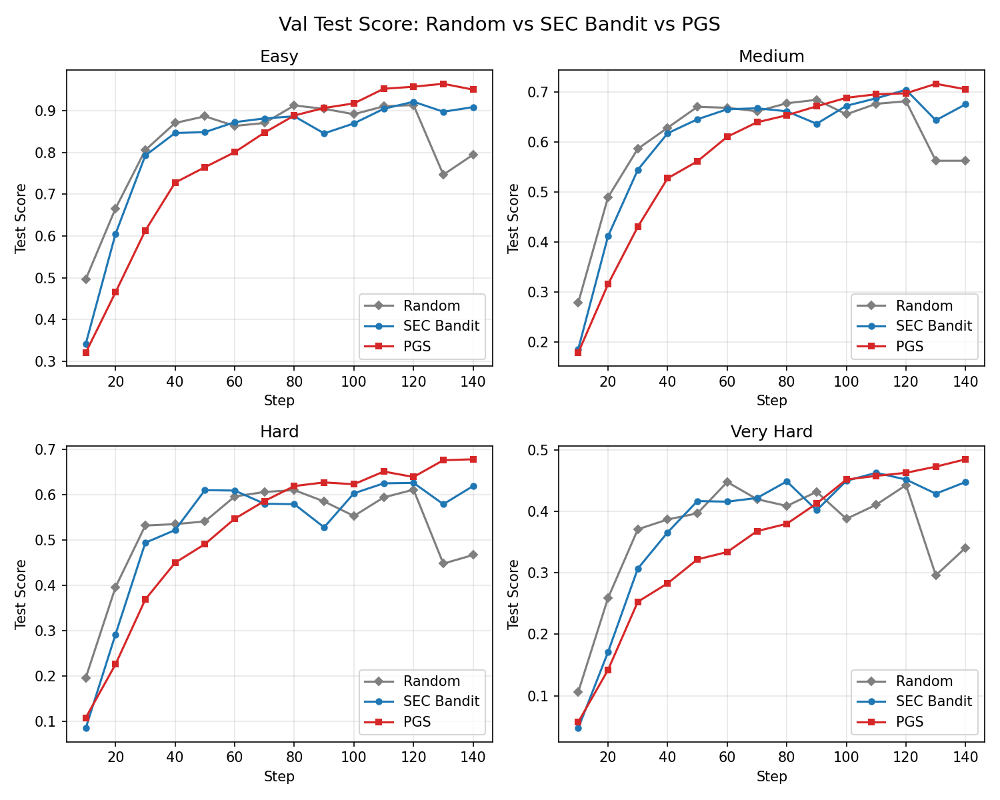
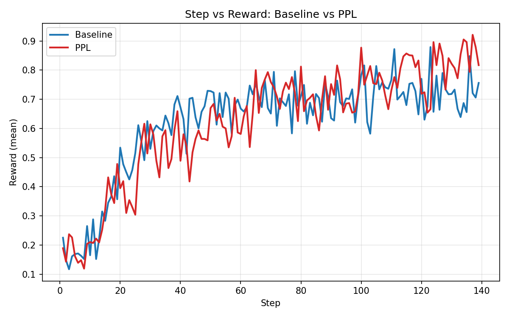

# Perplexity-Guided Sampling for Efficient RL-Based LLM Fine-Tuning

This repository contains the code and project artifacts for **Perplexity-Guided
Sampling (PGS)**, a curriculum-learning method for GRPO-based language-model
fine-tuning. The implementation compares four sampling strategies:

- **Random**: uniform sampling without a curriculum.
- **Bandit**: difficulty-group selection using the observed advantage signal.
- **PGS**: global ordering by prefix perplexity, prioritizing uncertain samples.
- **Hybrid**: bandit selection between difficulty groups and PGS ordering within
  each selected group.

The implementation extends [ServiceNow/sec](https://github.com/ServiceNow/sec),
which is built on [verl](https://github.com/volcengine/verl).

## Project artifacts

- [Project report](docs/project-report.pdf)
- [Presentation](docs/project-presentation.pdf)

## Repository layout

```text
.
├── data/countdown/                 # Countdown train/test Parquet files
├── docs/                           # Report and presentation
├── examples/                       # Reproducible experiment launchers
├── results/                        # Plotting scripts and exported figures
├── verl/                           # Extended verl/SEC implementation
│   └── verl/
│       ├── trainer/ppo/            # Curriculum integration in the trainer
│       └── utils/auto_curriculum/  # PGS and hybrid priority logic
├── download_model.sh
├── requirements.txt                # Snapshot of the tested environment
└── setup_server.sh
```

The main PGS implementation is in
[`verl/verl/utils/auto_curriculum/entropy.py`](verl/verl/utils/auto_curriculum/entropy.py).
Strategy construction and priority updates are in
[`verl/verl/utils/auto_curriculum/priority.py`](verl/verl/utils/auto_curriculum/priority.py).

## Setup

The experiments were developed with Python 3.10, PyTorch 2.x, CUDA, vLLM
0.6.3, Ray, Hydra/OmegaConf, Transformers, and Datasets. A CUDA-capable Linux
machine is required for training.

```bash
conda create -n pgs python=3.10 -y
conda activate pgs
pip install -r requirements.txt
pip install -e verl/
```

Alternatively, adapt and run `setup_server.sh` for the CUDA version installed on
your server.

Download the default model:

```bash
bash download_model.sh
```

## Data

The experiment launchers expect:

```text
data/countdown/train.parquet
data/countdown/test.parquet
```

The training set contains Easy, Medium, and Hard examples. Very Hard examples
are held out for evaluation. The data files originate from the upstream SEC
repository and are included for reproducibility.

## Reproducing experiments

All runs use the same launcher. The examples below show the settings that differ
between strategies; append hardware-specific overrides as needed.

### Random baseline

```bash
bash examples/countdown.sh countdown_random_baseline \
  trainer.sec.enable=False \
  trainer.total_training_steps=140
```

### SEC bandit baseline

```bash
bash examples/countdown.sh difficulty_bandit_baseline \
  trainer.sec.enable=True \
  trainer.sec.strategy=bandit \
  trainer.sec.bandit.lr=0.5 \
  trainer.sec.bandit.objective=adv \
  trainer.total_training_steps=140
```

### PGS

```bash
bash examples/countdown.sh difficulty_pgs \
  trainer.sec.enable=True \
  trainer.sec.strategy=pgs \
  trainer.sec.ppl.update_interval=10 \
  trainer.sec.ppl.sample_size=5000 \
  trainer.total_training_steps=140
```

### Hybrid bandit + PGS

```bash
bash examples/countdown.sh difficulty_hybrid \
  trainer.sec.enable=True \
  trainer.sec.strategy=hybrid \
  trainer.sec.bandit.lr=0.5 \
  trainer.sec.bandit.objective=adv \
  trainer.sec.ppl.update_interval=10 \
  trainer.sec.ppl.sample_size=5000 \
  trainer.total_training_steps=140
```

## Key hyperparameters

| Parameter | Value |
|---|---:|
| Initial model | Qwen2.5-Math-1.5B |
| Actor learning rate | 5e-6 |
| Training batch size | 32 |
| Rollouts per prompt | 8 |
| Training steps | 140 |
| Bandit EMA coefficient | 0.5 |
| PGS prefix length | 128 tokens |
| PGS update interval | 10 steps |
| PGS sample size | 5,000 |

## Results





The raw training logs are intentionally excluded from version control. The
scripts in `results/` regenerate the figures from locally available logs.

## Acknowledgements

This work modifies the Apache-2.0-licensed
[ServiceNow/sec](https://github.com/ServiceNow/sec) codebase and its vendored
verl implementation. The original license and notices are retained in this
repository.
